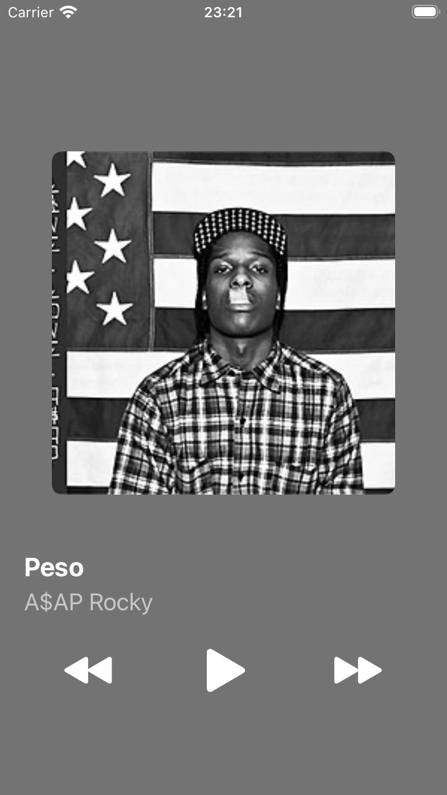
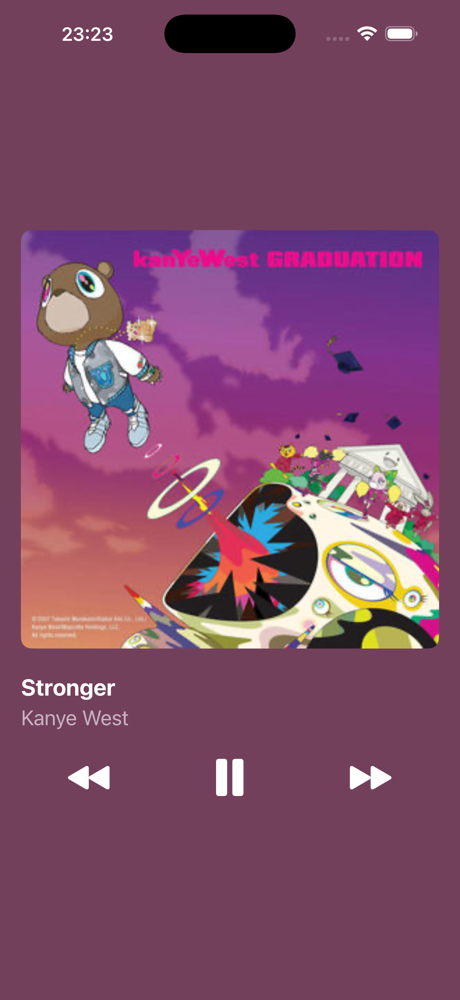

# Music Player — UIStackView & Auto Layout

Single-screen UIKit music player: cover, title, artist and Previous / Play-Pause / Next controls that play audio files bundled with the app.

## Features

- Layout built entirely in `Main.storyboard` with nested `UIStackView`s (root, labels, controls)
- Root stack pinned to the Safe Area (20 pt leading/trailing), vertically centered
- Square cover (1:1 aspect ratio) on every screen size
- 10 bundled tracks (`.mp3`) with matching covers in `Assets.xcassets`
- Playback with `AVAudioPlayer`, play state preserved on track change
- Wrap-around navigation and auto-advance via `AVAudioPlayerDelegate`
- Missing or broken files are handled with a log message and an alert, no crash

## Project structure

```
MusicPlayer/
├── Models/
│   ├── Track.swift
│   └── TrackLibrary.swift
├── ViewModels/
│   └── PlayerViewModel.swift
├── Controllers/
│   └── PlayerViewController.swift
├── Audio/
│   └── track01.mp3 … track10.mp3
├── Assets.xcassets/
│   └── cover01 … cover10
└── Base.lproj/
    └── Main.storyboard
```

## Run

Open `MusicPlayer.xcodeproj` in Xcode, select an iPhone simulator and press Run. No extra setup required.

## Screenshots

| iPhone SE (3rd gen) | iPhone 16 Pro Max |
|---|---|
|  |  |

## Demo

[Screen recording](Screenshots/demo.mov)


